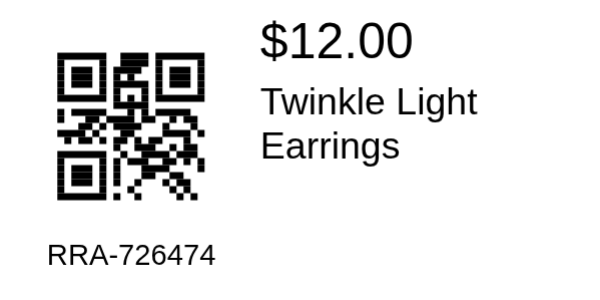

# Ramsey Labels for WooCommerce

Free, independent WooCommerce label design, SKU barcodes, complete batch previews,
thermal/sheet browser printing and lossless raster PDF export.

**Engineering release candidate: not yet approved for publication or production.**
See [release readiness](docs/release-readiness.md) for actual results and blockers.
No code has been pushed or submitted to WordPress.org.

## What it does

- Product/variation name and SKU search, category filtering, paginated results and thumbnails.
- Product row links and Products > All Products bulk-action queue handoffs.
- Queue thumbnails, names, SKUs, prices, selection and quantities.
- Automatic, vertically stacked previews of the entire selected batch.
- Thermal roll and sheet geometry, skipped slots, offsets and saved print profiles.
- Visual text, barcode, image and shape elements; optional inert HTML layouts.
- QR-left / SKU-below / price-and-name-right 50.8 × 25.4 mm card.
- CODE128, CODE39, EAN-13, EAN-8, UPC-A, UPC-E, QR and ECC200 Data Matrix.
- JSON library import/export, CSV import/export, order/item and alternate record adapters.
- Read-only legacy configuration discovery with explicit migration preview and backup/restore.

No runtime npm/Composer libraries, fonts, external scripts, telemetry or barcode services.
This is not an implementation or API clone of any commercial product.



*Generated from the tested PDF and independently decoded; not a photograph of a hardware print.*

## Requirements and installation

Use an isolated staging installation with WooCommerce and a modern browser.
[Compatibility](docs/compatibility.md) distinguishes tested combinations from inherited,
unverified environments. The tested floor is WordPress 6.0.3 / PHP 7.4.32 (Apache) / WooCommerce 7.0.1.

Build with `python3 bin/build.py`, then upload the ZIP via Plugins > Add New.
The package deliberately retains `ramsey-labels-independent/ramsey-labels-independent.php`
for RC8 update safety. Do not install a second copy under `ramsey-labels`.
See [migration](docs/migration.md) for the proposed directory slug conflict.

## Quick start

1. Open **WooCommerce > Ramsey Labels** and choose the thermal 2 × 1-inch profile.
2. Use Design to choose a template, edit elements and dimensions, then **Save settings**.
3. Under **Products & orders**, search by name/SKU and press Enter, or choose a category
   and click Search. Previous/Next paginate; select results and **Add selected to job**.
4. Set quantities and open **Print preview**. All selected pages render automatically.
5. Choose **Export PDF**, or **Print** with scale 100%, margins none, headers/footers off.

From Products > All Products select rows, choose **Ramsey: print product labels** and Apply.
Only selected IDs are handed off in a short-lived, current-user-scoped token.

## Designer and saved libraries

Select an element to edit it, or Tab to an element and press Enter to access its numeric
position fields. Dragging is optional. Text expressions use `{{name}}`, `{{price}}`,
`{{sku|id}}` (fallback), or explicit custom metadata bindings. Save as template for reuse.
Duplicate profiles for different media. Export the JSON library before upgrading.
Import replaces editor contents only; Save settings persists validated configuration.
CSS with URL-bearing functions, escapes or at-rules is rejected, not executed.

## QR, SKU and WCPOS

The default card encodes `RRA-726474` exactly, not a product URL. Empty SKU falls back
to product ID. CODE128 preserves ASCII alphanumeric SKUs; CODE39 requires uppercase.
Retail EAN/UPC formats accept digits only and validate checksums. Do not choose retail
formats for hyphenated SKUs. Scanner output settings can expand UPC-E or prefix UPC-A;
configure your scanner/POS lookup accordingly. Software round-trip checks are not live
WCPOS integration certification. Existing SKU-generation hooks are not modified.

## Printer setup and PDF

Set the driver stock size to 50.8 × 25.4 mm for the default roll profile. Disable fit-to-page,
choose actual size, and calibrate gap sensing/feed using your printer's instructions.
Sheet profiles have independent margins, gaps, rows, columns, flow and X/Y calibration.
Test one sheet/label before a large batch. PDF labels are lossless RGB rasters at profile
DPI; vector output and physical printer validation are not claimed.

## Troubleshooting

- No products: activate WooCommerce, check staff permissions and refine category/search.
- Search works via CLI but not browser: run the plain/permalink browser regression tests;
  check the browser console and REST response, without sharing private order payloads.
- Barcode too dense: increase box width/DPI or shorten the payload. QR quiet zones are required.
- Text overflow: enlarge the element or reduce its minimum font size; rendering errors block printing.
- Unexpected pages: review quantities, selected rows, sheet capacity and skipped slots.
- Image failure: use a local WordPress media attachment. External image requests need consent
  and CORS; credentials in image URLs are rejected.
- Conflicting settings save: another tab updated the revision. Export edits before reloading.
- Preview limits: split jobs exceeding 2,000 labels, 1,000 records or image memory budgets.

## Security and privacy

Administrative REST routes require capabilities; WordPress cookie auth supplies REST nonce
verification. Order adapters use WooCommerce CRUD. Jobs can contain customer addresses;
restrict staff access and protect exported files and backups. Uninstall preserves data unless
the explicit purge constant is enabled. See [SECURITY.md](SECURITY.md),
[audit](docs/security-audit.md), and [privacy details](docs/security.md).

## Development and tests

Node/npm, Python 3, Docker Compose and Composer/PHP (or the documented containers) are needed.
No production connection is required or permitted for these tests.

```sh
npm ci
composer install
npm test
npm run lint
composer test
composer analyse
composer lint
docker compose up -d wordpress
bash bin/setup-test-site.sh
bash bin/integration.sh
npm run test:e2e
python3 bin/build.py
```

See [development](docs/development.md), [test coverage and limitations](docs/testing.md),
[architecture](docs/architecture.md), and [release process](docs/release-process.md).
CI is designed to fail outstanding standards/security gates, not conceal them.

## Contributing, support and license

Use the repository issue templates for reproducible, redacted bug reports once the owner
approves publication. See [CONTRIBUTING.md](CONTRIBUTING.md) and
[CODE_OF_CONDUCT.md](CODE_OF_CONDUCT.md). No commercial support or response SLA is promised.
For vulnerabilities, follow SECURITY.md; do not post customer data or exploit details publicly.

GPL-2.0-or-later, author credit inherited from RC8: **Ramsey Resin Art, owner confirmation pending**.
No proprietary artwork or commercial package was consulted or copied in this engineering pass.
Original-source authorship still needs an owner attestation; inspection alone cannot prove provenance.
Independent barcode decoders are development-only dependencies and are not shipped.
See [license/provenance inventory](docs/provenance.md) and LICENSE.

### Safe sample visuals

Browser tests generate `build/synthetic-preview.png` and `build/labels-e2e.pdf` using only
Twinkle Light Earrings / RRA-726474 / $12.00 and a generated purple image.
These local evidence files are not production assets. Directory screenshot/banner/icon work
is tracked in [submission checklist](docs/wordpress-org-submission.md).
