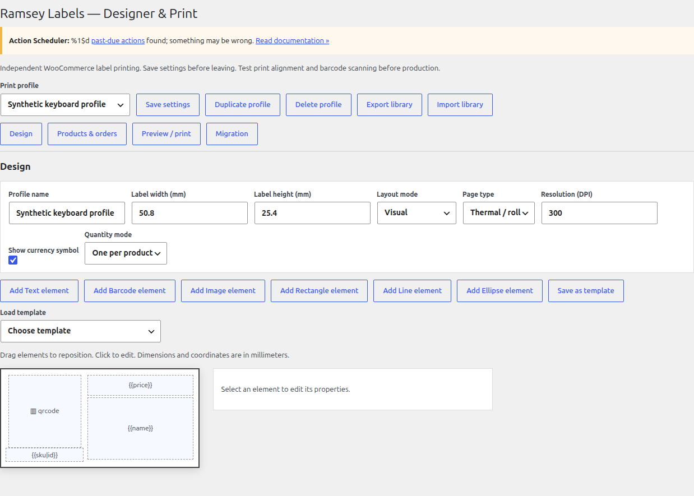
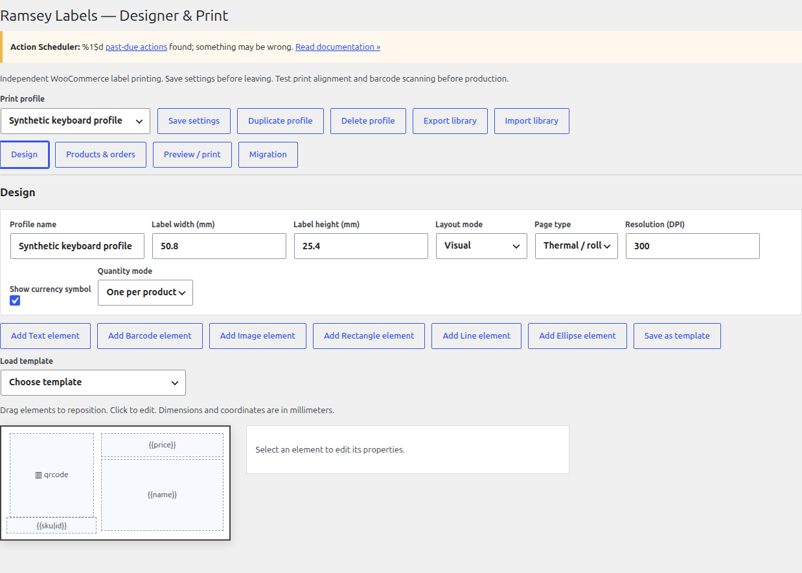
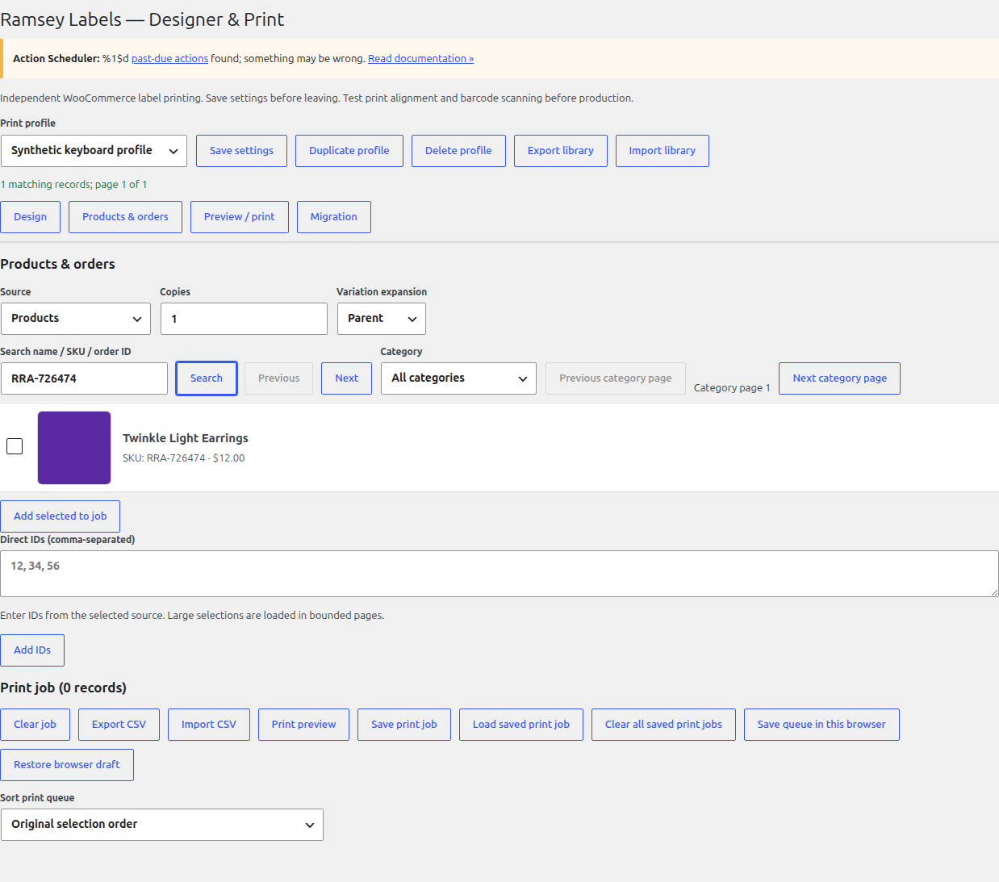
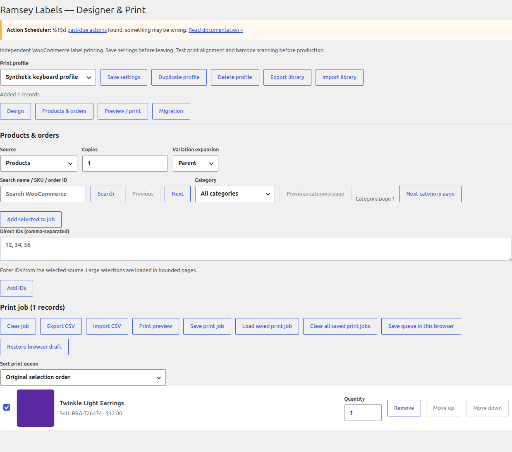
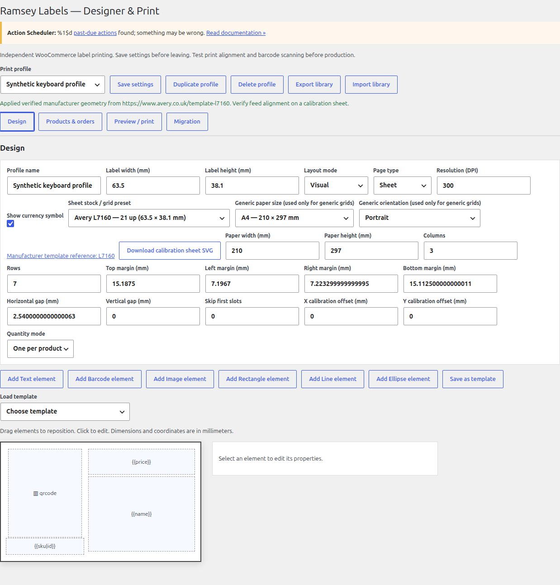
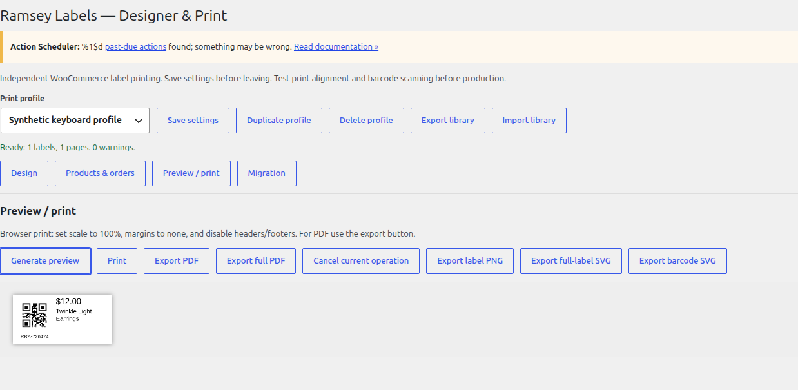

# Ramsey Labels for WooCommerce

**Free, open-source WooCommerce barcode, QR, and product label printing.** Design labels visually,
search and bulk-select products, print thermal or sheet labels, and export PDF, PNG, or SVG—without
license keys, premium feature gates, telemetry, or artificial total-print quotas.

> **Release candidate:** RC11 is software-verified but is not a stable public release. Physical
> printer/scanner/WCPOS acceptance and owner publication approval remain pending. Read
> [release readiness](docs/release-readiness.md) before production use.



## Install

1. Use an isolated staging WooCommerce site and back up existing label settings.
2. Install the appropriate [release candidate artifact](docs/github-release-draft.md):
   - `ramsey-labels-independent-*.zip` for in-place RC8/RC9/RC10 upgrades.
   - `ramsey-labels-*.zip` only for the separately tested public-directory transition.
3. **Never activate both ZIP identities at once.**
4. Open **WooCommerce → Ramsey Labels**, choose a profile, add products, preview, then test-print at
   actual size before a production batch.

## Highlights

- **Visual label designer** — text, product images, barcode elements, lines, rectangles, ellipses,
  alignment, rotation, conditions, saved profiles, and reusable templates.
- **Product workflows** — name/SKU search, category filtering, WooCommerce Products bulk actions,
  queue thumbnails, quantities, keyboard reordering, and stable name/SKU sorting.
- **Real WooCommerce thumbnails** — simple-product images, variation-specific images, parent-image
  fallback, and a clear missing-image placeholder are retained from search through print queue.
- **Label media** — default 2 × 1 inch thermal QR-left/SKU-below card; A4, Letter, P4, generic
  sheets, verified A4 stock presets, offsets, start slots, and printable calibration SVGs.
- **Barcode formats** — CODE128, CODE39, EAN-13, EAN-8, UPC-A, UPC-E, QR Code, and Data Matrix
  ECC200. GS1-128 is limited to the documented [supported AI subset](docs/gs1-support-matrix.md).
- **Export** — complete multi-page PDF, label PNG, barcode-only SVG, and full-label SVG with vector
  text/shapes/barcodes plus bounded embedded raster product images.
- **WooCommerce data** — products, variations, order items, orders, coupons, users, posts, supported
  custom fields/attributes, CSV queue import/export, and JSON library import/export.
- **Large jobs** — paged lookups, bounded rendering segments, streamed PDF generation, cancellation,
  and no artificial total-print quota.
- **Privacy and security** — per-user saved jobs, capability checks, privacy export/erasure hooks,
  local attachment handling, resource budgets, no telemetry, and no external barcode service.

## Feature gallery

| | | |
|---|---|---|
| [](docs/screenshots.md) | [](docs/screenshots.md) | [](docs/screenshots.md) |
| [](docs/screenshots.md) | [](docs/screenshots.md) | [](docs/screenshots.md) |

See the [complete 24-screen gallery](docs/screenshots.md), including bulk selection, category
filtering, variation thumbnails, presets, calibration, exports, custom fields, orders, and keyboard
controls. All screenshots use synthetic data in an isolated WooCommerce fixture.

## Quick start

1. Choose a thermal or sheet profile under **Design**.
2. Search by product name or exact SKU under **Products & orders**, or select a category.
3. Select products, use a WooCommerce bulk action, or enter permitted direct IDs.
4. Check thumbnails, names, SKUs, prices, quantities, and sort order in the print queue.
5. Open **Print preview**. For a large job, navigate every bounded segment.
6. Print the active segment at 100% scale with margins, headers, and footers disabled, or use
   **Export full PDF** for every selected label.

The default QR card encodes the exact SKU (falling back to product ID), not a product permalink.
Software decoders verify the payload; scanner setup and WCPOS lookup still require owner acceptance.

## Labels, sheets, and exports

- Thermal profile: 50.8 × 25.4 mm / 2 × 1 inch. Confirm driver media size, actual-size scaling, and
  feed alignment with a plain-paper test first.
- Source-backed Avery A4 presets: L7159, L7160, L7162, L7163, L7164, and L7651. Other requested
  label counts are **generic grids**, not manufacturer compatibility claims. See
  [sheet presets](docs/sheet-presets.md).
- Calibration SVG marks labels, centers, margins, pitch, offsets, and skipped positions. It verifies
  software geometry; it does not certify a printer.
- PDF is lossless raster at profile DPI. Full-label SVG is mixed vector/raster when product imagery
  is present and has no external resource dependencies.

## Compatibility and limits

The tested floor is WordPress 6.0.3 / WooCommerce 7.0.1 / PHP 7.4.33. Current CI also tests
WordPress 7.1.4 / WooCommerce 11.2.2 with legacy and HPOS storage. See
[compatibility](docs/compatibility.md) for exact scope.

Resource budgets protect browser/server stability: 2.2 MB library documents, 8 MB live browser
queue, 2 MB saved jobs per user, 4,096 elements/design, 16 megapixels/label, and 2,000 labels per
in-memory render segment. These are safety bounds, not paid-product restrictions; complete batches
use pagination and segments.

## Security, privacy, and support

- No telemetry, license keys, remote fonts, remote scripts, or barcode SaaS.
- External label images need session consent; local attachment reads are permission checked.
- Saved jobs can contain customer/order data and are private to the WordPress account on that site.
- See [security policy](SECURITY.md), [security scanning](docs/security-scanning.md), and
  [security audit](docs/security-audit.md). Do not include credentials, customer data, exports, or
  private URLs in public issues.

Hardware, scanner, WCPOS, macOS Safari, Windows, and hands-on assistive-technology certification
are not claimed. Use the [owner acceptance checklist](docs/owner-acceptance.md).

## Developers

The documented PHP hooks include `rli_field_value` and `rli_records`; the browser API is exposed at
`window.RamseyLabels`. Read [API documentation](docs/api.md), preserve persisted keys and public
hooks, and validate all external values as bounded scalar data.

## Development and testing

```bash
npm ci --ignore-scripts
npm run lint
npm test
bash bin/integration.sh
npm run test:e2e
bin/release-supply-chain.sh
```

See [development](docs/development.md), [testing](docs/testing.md),
[security scanning](docs/security-scanning.md), and [release process](docs/release-process.md).
All test sites must be isolated and synthetic-only.

## Contributing

Focused, tested contributions are welcome after public contribution support is approved. Read
[CONTRIBUTING.md](CONTRIBUTING.md), [CODE_OF_CONDUCT.md](CODE_OF_CONDUCT.md), and the
[provenance requirements](docs/provenance.md). Do not copy commercial code/assets or add unknown-
license dependencies.

## License and provenance

Ramsey Labels is GPL-2.0-or-later. The owner has attested that the inherited implementation was
made fresh without copying; retain the documented supporting records and read the
[file-level provenance audit](docs/provenance/rc8-file-audit.md). This repository is not a
commercial-plugin API or template clone.
